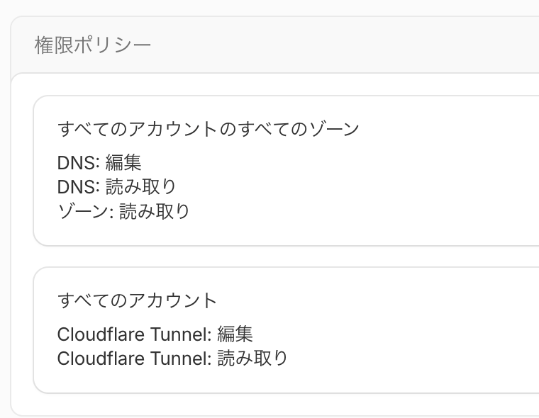

# Cloudflare インフラ管理 (Terragrunt / Terraform)

本ディレクトリでは、Cloudflare 上の DNS レコードおよび Zero Trust Tunnel (ハニーポット公開用) をコード管理する。

## 1. 認証情報管理ポリシー

外部システムの機密情報（API トークン）を Git リポジトリに残さないポリシーのため、SOPS 管理を廃止し **ローカル平文ファイル (`secrets.local.yaml`) による一時利用方式** を採用している。

- `secrets.local.yaml` は `.gitignore` に登録されており、Git にコミットされない。
- 作業時のみトークンを記入し、作業完了後はトークンを失効させるかファイルをクリアする。

## 2. API トークン発行と必要スコープ

Tunnel（アカウントリソース）と DNS（ゾーンリソース）を同時に管理するため、**My Profile（マイプロフィール） > API Tokens** から Custom Token を作成する。

### 必要スコープ (Permissions)
| リソース種別 | 権限レベル | 用途 |
| :--- | :--- | :--- |
| **Zone > DNS** | **Edit** | `staging-ext.wpcapp.net` CNAME および内部 DNS レコードの作成 |
| **Zone > Zone** | **Read** | ゾーン情報の参照 |
| **Account > Cloudflare Tunnel** | **Edit** | ハニーポット公開用 Zero Trust Tunnel の作成・設定 |

- **Account Resources**: 対象アカウント（または All accounts）
- **Zone Resources**: `wpcapp.net`（または All zones）
- **TTL**: 7 日間など一時的な有効期限を設定することを推奨



## 3. リリース手順 (疎通までのステップ)

### Step 1: ローカル秘密ファイルと ID の設定
1. トークン設定ファイルを作成:
   ```bash
   cp secrets.local.yaml.example secrets.local.yaml
   # secrets.local.yaml を開き、cloudflare_api_token に発行したトークンを記入
   ```
2. `main.tf` の先頭プレースホルダーに実際の ID を記入:
   ```hcl
   locals {
     account_id = "..." # Cloudflare の Account ID
     zone_id    = "..." # wpcapp.net の Zone ID
   }
   ```

### Step 2: Terragrunt の適用
```bash
# 差分確認 (precondition ガードを通過することを確認)
terragrunt --working-dir terraform/cloudflare plan

# 適用 (Tunnel と CNAME レコードを作成)
terragrunt --working-dir terraform/cloudflare apply
```

### Step 3: Tunnel トークンの取得
```bash
terragrunt --working-dir terraform/cloudflare output -raw honeytrap_tunnel_token
```

### Step 4: nuage-honeytrap への配線とデプロイ
1. `nuage-honeytrap` 側の `k8s/overlays/prod/secrets/prod-secrets.yaml` に取得したトークンを設定し、SOPS 暗号化してコミット。
2. 両リポジトリの PR をマージし、Argo CD が自動同期して完了。
